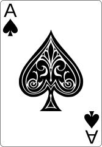

# 52 Playing Cards Deck 🃏

An interactive, responsive web application displaying all 52 standard French / Anglo-American playing cards arranged in rows. Built with clean, vanilla HTML5, CSS3, and JavaScript, featuring authentic vector card illustrations, an **Auto Mode** engine, and dynamic responsive scaling.



---

## ✨ Features

### 🎴 Authentic Playing Card Artwork
- **Double-Headed Reversible Court Figures**: Traditional, detailed royal illustrations for all **Jacks**, **Queens**, and **Kings**:
  - **♠ Spades**: King David of Israel, Queen Pallas Athena, and Jack Ogier the Dane.
  - **♥ Hearts**: King Charlemagne ("The Suicide King"), Queen Judith, and Jack La Hire.
  - **♦ Diamonds**: King Julius Caesar, Queen Rachel, and Jack Hector of Troy.
  - **♣ Clubs**: King Alexander the Great, Queen Argine, and Jack Sir Lancelot.
- **Classic 4-1-4 Number 9 Layout**: All Number 9 cards have their ninth pip positioned directly in the vertical and horizontal center between outer columns, matching standard casino/poker decks.
- **Pure Vector Graphics (SVG)**: Razor-sharp on 4K, Retina, and mobile displays without pixelation.

### 📐 Multiple Row & Grid Layouts
- **4 Suits (Rows)** *(Default)*: Each suit (Spades, Hearts, Diamonds, Clubs) has its own dedicated row with Ace through King.
- **13 Ranks (Rows)**: 13 rows grouped by rank (Aces row, 2s row, ... Kings row) across all 4 suits.
- **Continuous Grid**: Fluid, responsive card grid.
- **⚡ Auto-Fit Rows**: Automatically scales all 13 cards dynamically to fit within any window width without horizontal scrollbars.
- **↔ Scroll Mode**: Allows fixed-width cards with smooth horizontal touch/wheel scrolling.

### ⚡ Interactive Auto Mode
- **Automated Dealing**: Deals all 52 cards row by row with realistic drop-in flight animations.
- **Royalty & Ace Spotlight**: Automatically highlights key court cards and displays lore tooltips.
- **Deck Flip Demonstration**: Smooth 3D animation showcasing the royal blue casino lattice card backs.
- **Controls**: Live status banner, Pause/Resume, Re-deal, Speed toggle (0.5x, 1x, 2x), and Audio Mute/Unmute.

### 🔊 Audio Synthesis & Themes
- **Synthesized Card Sounds**: Realistic card snap, shuffle, and deal sounds generated client-side via the HTML5 Web Audio API (zero external audio files or dependencies).
- **Three Visual Themes**:
  - 🎨 **Emerald Felt Table**: Classic casino felt with radial lighting and subtle felt texture.
  - 🌙 **Midnight Dark**: Sleek dark slate aesthetic with neon blue accents.
  - ☀️ **Studio Light**: Clean, minimalist light gallery view.

### 🔍 Card Inspection Modal
- Click or press Enter on any card to view a high-resolution spotlight display, card lore, traditional court figure background, suit symbolism, and Blackjack values.

---

## 📁 Repository Structure

```text
.
├── cards/                  # All 52 vector playing cards (SVG)
│   ├── ace_of_spades.svg
│   ├── king_of_hearts.svg
│   ├── queen_of_diamonds.svg
│   ├── jack_of_clubs.svg
│   └── ... (all 52 cards)
├── index.html              # Main standalone application (HTML/CSS/JS)
├── README.md               # Documentation
└── GEMINI.md               # Workspace guidelines
```

---

## 🚀 Getting Started

No build tools, bundlers, or servers required!

1. Clone or download this repository:
   ```bash
   git clone https://github.com/nakic2000/cards.git
   cd cards
   ```
2. Open `index.html` in any modern web browser:
   - **Linux / macOS**: `xdg-open index.html` or `open index.html`
   - **Windows**: `start index.html`
   - Or simply double-click `index.html`.

---

## 📜 Credits & License

- **Court Card & Pip Vectors**: Based on the public domain / CC0 vector playing card sets by David Bellot.
- **Code & Layout**: Open source under the [MIT License](LICENSE).
